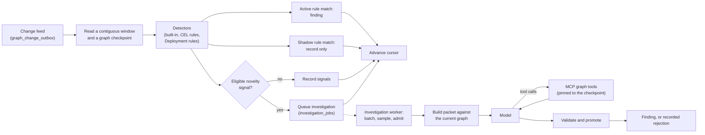

# Change feed and reasoning

Detection turns graph changes into signals and findings. It reads the change feed and runs deterministic detectors. An active detection rule match becomes a finding immediately. A novel change that deserves a closer look is queued for agentic investigation: a language model investigates through read-only graph queries, and its answer becomes a finding only if it passes deterministic checks.

The model is an advisor. AgentShield decides what the graph contains, what the model may query, which evidence is valid, and whether a result becomes a finding.

Code: `pkg/reasoning` (detection service, investigation queue and worker, packets, validation, promotion), `pkg/reasoning/mcpserver` (MCP tools), `pkg/reasoning/modelanalyzer` (model calls and retries), `pkg/detector` (signals). How the change feed is written is described in [Publication and storage](publication-and-storage.md#the-change-feed).

## Flow

Detection and agentic investigation are separate stages with separate progress, so a slow or failing model never delays detection or rule findings.



The change feed only says *what changed*. The checkpoint supplies the current graph, and telemetry is fetched through tools. Nothing in the trigger path needs the full graph or raw telemetry.

## Detection and investigation

Detection runs when `--agentic-investigation` or `--deployment-rule-authoring` is enabled. It never calls a model; there is no detection-only mode. The three stages are independent:

| | Detection | Agentic investigation | Deployment rule authoring |
| --- | --- | --- | --- |
| Code | `reasoning.Service.Run` | `reasoning.InvestigationWorker` | `deploymentauthoring.Worker` |
| Input | Every change window | Windows with an eligible novelty signal | First appearance of each Kubernetes Deployment |
| Progress | `reasoning_cursors` | `investigation_jobs` | `deployment_rule_jobs` |
| Calls a model | Never | At most once per admitted job | Once per Deployment |
| Batching | One window per poll (`--detection-interval`, at most 1,000 changes) | Requests that share an anchor coalesce while a job waits `--agentic-investigation-batch-window` (30 s), up to 1,000 changes per job | One job per Deployment |
| On failure | A failure confined to one window is recorded and skipped; a store failure stops it without advancing the cursor | Retries the job with backoff up to `--agentic-investigation-max-attempts`, then marks it failed. An expired lease (a crashed worker) counts as a failed attempt toward the same limit | Retries with exponential backoff; after 8 attempts, or a request the model endpoint rejects as invalid, the job fails until requested again. A job whose revision was superseded is dropped |

Rule execution, including approved and shadow Deployment rules, happens inside detection. Authoring a Deployment rule is a model call; running one is not. See [Detection rules](detection-rules.md#model-authored-deployment-rules).

## Consuming the change feed

`reasoning.Service.Run` polls the change feed every `--detection-interval` (default 1 second):

1. Read the consumer's cursor from `reasoning_cursors` (consumer ID `--detection-consumer`, default `reasoning/default`).
2. `ReadChangeWindow` takes a graph checkpoint, then reads events after the cursor up to the checkpoint's sequence. Events newer than the checkpoint are left for the next window.
3. If events are missing (a gap) or a read limit stops the window short of the checkpoint, the service rebases to the checkpoint instead of guessing what it missed.
4. Detect, then record signals, rule findings, finding invalidations, and any investigation request (below).
5. Advance the cursor to the checkpoint's sequence and graph digest.

A detection failure confined to one window, such as a CEL runtime error or a detector panic, does not stop the service. The window is recorded with its error and no signals, the failure is logged and counted, and the cursor moves on. Rule matches in that window are lost. Its changes still invalidate stale agentic findings. A window larger than the detector's bounds is evaluated up to them, and the rest is counted and logged (see [Detection rules](detection-rules.md#limits)). A store, sink, or cursor error still stops the service, and the next start rebases.

Several events can touch the same resource. The service does not process them one by one; it compares the previous graph with the checkpoint graph once per window.

### Startup and restarts

The store cannot rebuild the graph at an old sequence. So on first start, or when the stored cursor lags behind the current checkpoint after a restart, the service records a `startup_without_historical_snapshot` rebase and starts from the current graph. It does not claim to have analyzed changes made while it was down. While running, it evaluates every window.

### Crashes and repeats

The result is recorded before the cursor moves. A crash between the two leaves the cursor behind, so the next start rebases instead of re-detecting that window. Signal and finding IDs are deterministic, so anything recorded twice is stored once. Writing the results and advancing the cursor in one transaction is not implemented yet.

## Detection

Detectors compare the previous and current graph and return signals. A signal says "look at these resources" and carries a risk level, reasons, and anchor resource IDs. It is not a finding.

Built-in checks (`pkg/detector/builtin.go`) always run, whatever CEL ruleset is active. Scores of 3 or more are medium risk and can lead to a finding; a score of 2 is low risk and is only recorded; lower scores are dropped.

- **New communication path.** A resolved `communicates-with` edge creates a workload-level path. From a source that already had observed traffic, it scores 3 (medium); from a source with no prior traffic, such as a new workload, it scores 2 (low). Sensitive destination roles add 3 (`control-plane-api`) and a public destination adds 1.
- **Traffic novelty.** A telemetry rollup with a new workload-level combination of kind, endpoints, operation, and outcome. It scores 1, plus 1 for a never-seen endpoint pair, plus the sensitive-role weight.
- **New exposure.** Security semantics become `external-addressable` (high risk).
- **Removed security semantics** and **lost governance** (high risk), and **changed security semantics** (medium risk).
- **Sensitive resource created.** A new Kubernetes RoleBinding, ClusterRoleBinding, or admission webhook configuration (medium risk).
- **Workload identity changed.** A workload's instances start using a service account it did not use before (medium risk).

Novelty is compared per workload: a Pod is folded into the controller that instantiates it, so rollouts, restarts, and scaling are not novel. Ordinary topology churn (new Pods, Services, ConfigMaps, labels, and structural edges) produces no signal. The scores are listed in [Detection rules](detection-rules.md#built-in-novelty-detection).

The detectors read only security semantics, registered predicates, neutral attributes such as `network/role`, and telemetry fingerprints. They never read provider-specific fields.

Operators can add CEL rules on top of the built-in checks, and approved model-authored Deployment rules run beside them. Each signal is routed by where it came from:

- **Active rule match** (an operator-activated CEL rule or an approved Deployment rule): becomes a finding immediately, with no model call. See [Rule findings](#rule-findings).
- **Shadow rule match** (an unreviewed Deployment rule): recorded only.
- **Built-in novelty signal**: queued for agentic investigation when at least one is medium risk or higher, because promotion requires one.

Every signal is recorded in `detection_signals` with what happened to it: `rule_finding`, `shadow`, `queued`, `below_threshold` (no eligible signal), `disabled` (agentic investigation is off), or `investigated` (inline evaluation). Signals are kept for `--detection-signal-retention` (seven days). Inspect them with `agentshield rules signals`.

Detection runs only when a change window exists. Telemetry-only rollup updates do not create change-feed events, except when a `communicates-with` edge appears or expires. A telemetry rule watching for a new operation or outcome on a pair that already communicates therefore waits for the next unrelated graph change. It is evaluated then, unless the rollup's 24-hour retention has dropped the combination. Waking detection on new telemetry combinations is planned follow-up work.

## The investigation queue

Detection hands each eligible window to the queue as an `InvestigationRequest`. The request carries the window's change range, its built-in novelty signals (at most 256), the topology classification, and incident context scoped to the signals' anchors (at most 256 events and 256 baselines), so the worker needs nothing from detection's memory.

Only an eligible window gets a packet and a request; a window without one is recorded with its signals and nothing else.

Requests that share an anchor coalesce into one queued job while its batch window (`--agentic-investigation-batch-window`, 30 s) is open, as long as the combined change range stays within 1,000 changes. The worker claims the highest-risk job first, oldest first within a risk. Before calling the model it drops anchors that have left the graph, skipping the job as `stale` if no eligible signal remains, and then applies sampling:

1. **Rate sampling** (`--agentic-investigation-sample-rate`, default 1) runs that fraction of medium-risk jobs. High and critical jobs always run. The decision is a deterministic function of the job's signal IDs, so retries agree and recurrences of a pattern are sampled independently.
2. **Deduplication** (`--agentic-investigation-dedup-window`, default one hour) skips a job whose fingerprint, the risk, reasons, and anchors of its eligible signals without time windows, was already investigated within the window. Failed jobs do not count.
3. **Budget** (`--agentic-investigation-max-per-hour`, default unlimited) caps investigations started in any trailing hour. Over budget, medium-risk jobs are skipped and high and critical jobs wait a minute and retry.

Deduplication and the budget are checked under one PostgreSQL advisory lock. A skipped job ends `sampled_out` with its reason (`stale`, `sampled`, `duplicate`, or `budget`) and never calls the model. An admitted job keeps its admission across retries. Finished jobs are pruned after `--detection-signal-retention`. Inspect the queue with `agentshield rules investigations`.

With the defaults, only batching and deduplication limit spend. Set the sample rate and hourly budget to cap it.

## The packet

The investigation worker re-reads the job's change range from the outbox and builds a compact packet (`pkg/reasoning/packet.go`) against the **current** graph checkpoint, which may be newer than the window that produced the request. The packet records both: the trigger sequence range and the hydrated sequence. It contains:

- the trigger sequence range, the hydrated checkpoint's sequence and graph digest, and the evaluation time;
- the non-telemetry assertions added and retracted in the trigger range;
- the topology classification computed at detection time;
- the affected resources (ID, kind, `network/role`): signal anchors first, then resources touched by a change, then other resources up to the limit;
- the resolved relationships and facets of those resources, with their decoded security semantics and opaque evidence IDs: those between or on signal anchors and changed resources first, then those touching another included resource. Facts touching no included resource are left out;
- the novelty signals, suggested anchor resources, query templates, and a fixed telemetry time window; and
- counts of anything left out because of size limits: at most 500 changes, 100 resources, 250 relationships, and 250 facets. A window that touches more resources than the limit, such as a large rollout, keeps the highest-priority ones and records the rest as `requiredResources` instead of failing.

The packet does not contain telemetry, provider-native configuration, precomputed attack paths, rule signals, or any hint about the expected answer.

The packet's analysis ID, graph digest, and telemetry window pin every later query to the exact state that was analyzed.

## Investigation tools

The model investigates through six read-only MCP tools (`pkg/reasoning/mcpserver`):

| Tool | Returns |
| --- | --- |
| `get_security_neighborhood` | One-hop security neighborhood of the given resources |
| `get_telemetry_chain` | Traffic observations connected to the given resources |
| `get_governance_posture` | Governance relationships and facets, without inferring policy effect |
| `find_graph_paths` | The resources, relationships, and facets within a fixed number of hops of the given resources. It returns that subgraph, not a list of individual paths. Follows every predicate except `runs-on` unless an explicit predicate list is passed. |
| `get_incident_timeline` | Ordered observations for the given resources across the incident |
| `get_behavior_baseline` | Previously observed communication for the given resources |

Each tool takes resource IDs as anchors, rejects IDs that are not in the pinned checkpoint graph, runs against that full graph, and returns a size-limited result marked `untruncated` or `truncated`. `untruncated` means every match in the pinned graph fit in the result. It does not mean the providers were fully observed. A candidate finding that depends on a truncated result is rejected.

The host runs the tools through a real MCP client session in the same process. Results are merged into the *effective packet* that is kept for audit and validation. Tool results contain evidence IDs, never evidence payloads.

`--agentic-investigation-retrieval` selects how tools are used:

- `model_selected` (default): the model chooses tools and anchors.
- `deterministic`: the host first fetches the behavior baseline, incident timeline, default graph paths, and governance posture for resources on those paths. The model may make more calls.

Each investigation is bounded: at most 16 model turns, 32 tool calls, 16 KiB of arguments per call, 256 KiB per tool result, and 1 MiB of tool results in total. Every turn replays the whole conversation, so the result budget also bounds each request. A call or result over budget is refused to the model rather than run or merged, and the last turn offers no tool, so the model must answer. Each attempt is also cancelled after 15 minutes. The retrieval mode is for measuring model capability, not a production cost control.

`cmd/agentshield-reasoning-mcp` serves the same tools over streamable HTTP at `/mcp` for a saved packet, so an MCP client can inspect a past investigation. It listens on `127.0.0.1:8090` by default. The server has no authentication; change the listener only behind authenticated infrastructure. See the [security model](../operations/security-model.md#reasoning-mcp-server).

```bash
go run ./cmd/agentshield-reasoning-mcp --packet packet.json [--telemetry-context telemetry.json]
```

## Validation and promotion

The model answers with strict structured output through the OpenAI Responses API. Requests use `store=false` and replay previous output items, including encrypted reasoning state when the model returns it.

A `candidate_finding` must cite selected signal IDs, affected resources from the packet, and at least one fact ID with one of that fact's own evidence IDs. A citable fact is any relationship, facet, telemetry, incident, or baseline fact in the effective packet: the initial packet or a tool result. Both come from the same pinned checkpoint. If the first answer cites IDs that fail these checks, the model gets one correction turn with the validation error and an allowlist of exactly the IDs validation accepts, and no tools. A second failure is final.

`reasoning.Promote` then applies these rules in order. The first rule that fails is recorded as the reason:

1. Baseline windows and packets with no signals are suppressed.
2. The model must choose `candidate_finding`.
3. The category `new_observed_communication` alone is never promoted; the model must name a specific consequence such as `loss_of_governance` or `possible_lateral_path`.
4. The answer must pass validation.
5. At least one selected signal must be medium risk or higher.

A promoted finding gets a deterministic ID. Model prose never overrides these rules.

## Findings

Every finding has an `origin`:

- `agentic_investigation`: promoted from a validated model assessment. It carries the model's category, severity, and uncertainty.
- `detection_rule`: created directly from an active rule match. See [Rule findings](#rule-findings).

Findings are stored in the `findings` table, with or without remediation suggestions, served at `/api/v1/findings`, and shown in the UI with their source.

An agentic finding records the resources it affects and starts `active`. A later contribution that adds or retracts an assertion on an affected resource marks older agentic findings from a different graph digest as `invalidated`. A rebase without change history invalidates every active agentic finding from an older digest. Because the worker investigates after detection has moved on, it checks the changes committed after its hydrated sequence once it records a finding, and invalidates the finding immediately if they touched its resources. Invalidated findings stay in the database for audit but cannot start a remediation.

### Rule findings

All matches of one rule revision in one change window form one finding, with category `detection_rule_match`, the rule's risk as severity, and the rule ID and revision. Its ID is derived from the rule, its signal IDs, and the graph digest, so a repeated window stores it once. A rule finding records that a rule matched, which later changes do not make untrue, so it is never invalidated automatically. It stays active until an acknowledgement workflow exists.

Findings are never published back into the graph, so they cannot trigger new detection.

## Remediation suggestions

The structured answer may include up to eight remediation suggestions. Each names one outcome from a closed list (`network.declare-ingress-isolation`, `transport.require-mutual-tls`, `gateway.prevent-route-delivery`) and exactly one affected target resource, and cites the same signal, fact, and evidence as a validated claim. Suggestions contain no YAML, patch, or command. Invalid suggestions are dropped; they do not discard an otherwise valid finding.

Each valid suggestion becomes a proposal on the finding. Reasoning never picks a provider and never plans or executes anything. See [Remediation](remediation.md).

## Runtime configuration

Agentic investigation runs only with `--agentic-investigation`, which requires `--model-endpoint` (or `AGENTSHIELD_MODEL_ENDPOINT`). The endpoint is a base URL; AgentShield calls `<endpoint>/v1/responses`. It must support the OpenAI Responses API with structured output and function calling, so `--model-provider=anthropic` cannot be combined with it. Anthropic applies only to Deployment rule authoring.

Model, reasoning effort (`--model-reasoning-effort`), retrieval mode (`--agentic-investigation-retrieval`), batching, and sampling are configurable. Each investigation attempt retries model calls up to three times. A request the model endpoint rejects as invalid (a 4xx status other than 408 or 429) is not retried, and the job fails at once. A job that panics fails at once, and a lease renewal that fails briefly is retried until the lease would expire. All flags are listed in [Configuration](../operations/configuration.md#detection-and-model-calling-features).

The evaluation harness in `evals/` calls `Service.EvaluateWindowWithIncident`, which detects a window and investigates it inline with the same investigator as the worker, so evaluations exercise the production detector, packet, tools, retries, validation, and promotion. Batching and sampling do not apply there. See [`evals/README.md`](../../evals/README.md).

## Limits

- Results are advisory. They are not proof of correctness.
- Restarts cannot catch up on missed history (see [Startup and restarts](#startup-and-restarts)).
- Incident history spans one process run; it is not stored durably.
- There is no outbox retention policy and no authentication. Model spend is bounded only by the investigation flags above; Deployment rule authoring makes one call per new Deployment.
- Telemetry rules wait for a graph change (see [Detection](#detection)).
- Rule findings are never invalidated automatically.
- Tenant isolation is out of scope.
