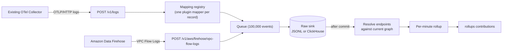

# Telemetry

Telemetry is how AgentShield learns what actually talks to what. Traffic records arrive at high volume, so they never pass through the discovery collections or the change feed. They go through their own pipeline, and only small per-minute summaries reach the graph.

This page is the reference for the telemetry pipeline, the normalized event schema, graph rollups, and failure behavior. Code: `pkg/telemetry`. Provider-specific mappers are documented on their plugin pages: [Istio](../plugins/istio.md#telemetry), [AWS](../plugins/aws.md#vpc-flow-log-telemetry), [Cilium](../plugins/cilium.md#hubble-flows), [agentgateway](../plugins/agentgateway.md#access-logs).

## Three representations

| Representation | Where | Used for |
| --- | --- | --- |
| Raw normalized events | JSONL file or ClickHouse `telemetry_events` | Audit, forensics, recomputation |
| Warehouse rollups | ClickHouse `telemetry_rollup_minute` | Long-window analytical queries |
| Graph rollups | Telemetry assertions in PostgreSQL | Joining recent traffic to the graph, the UI, reasoning queries |

Only graph rollups enter the graph. The raw sink is always the source of truth for complete events.

## Flow



## Ingestion

### OTLP logs

The recommended path is to add an exporter to an OpenTelemetry Collector you already run. Your existing exporters keep working; AgentShield gets a copy.

```yaml
exporters:
  otlp_http/agentshield:
    endpoint: http://127.0.0.1:8088
    encoding: proto
    compression: gzip

service:
  pipelines:
    logs:
      exporters: [existing_backend, otlp_http/agentshield]
```

If the collector cannot reach AgentShield on loopback, read the [security model](../operations/security-model.md#the-http-api-has-no-authentication) before changing `--listen`.

The receiver at `POST /v1/logs` accepts protobuf or JSON, optionally gzip-compressed, up to 16 MiB per request (compressed and decompressed). It converts each record into a provider-neutral `telemetry.LogRecord` and asks the mapping registry to convert it:

- Exactly one registered mapper must match each record. Records that match none, match several, or fail mapping are rejected through OTLP `partial_success`; the other records in the request continue.
- The plugin ID and source ID come from the mapper's registration, never from the payload.
- At most 8 requests are handled at once; more get `429` with `Retry-After` before their body is read.
- A request's events are queued all or none. When the queue cannot take them all, the receiver returns `429` with `Retry-After`; while the pipeline is shutting down, `503`. OTLP exporters retry both, and nothing from the rejected request was queued. A request with more events than the whole queue gets `413`.
- A mapper may skip a well-formed record it does not project (`telemetry.ErrSkipRecord`). Skipped records are neither ingested nor rejected.
- The receiver returns `200` once the accepted events are in the in-memory queue, before the raw sink has written them. See [Failure behavior](#failure-behavior) for what that means on a crash.

The only OTLP mapper today is the Istio waypoint access-log mapper. See [Istio telemetry](../plugins/istio.md#telemetry) for its attributes and an example access-log configuration.

### Provider-native receivers

A plugin may receive a provider's native format directly when that avoids extra infrastructure. The receiver must authenticate the provider, validate the configured source independently of payload fields, limit and decode the envelope, and produce normalized events into the same pipeline. The AWS VPC Flow Log receiver for Amazon Data Firehose is the only one today; see [AWS](../plugins/aws.md#vpc-flow-log-telemetry).

Cilium Hubble flows and agentgateway access logs have normalization functions, but no transport is wired into the binary yet.

### Writing a mapper

A plugin opts in by implementing `discovery.TelemetryMappingProvider`, which returns `telemetry.Mapping` values. Each mapping binds a `Mapper` to a plugin ID and source ID.

- `Match(LogRecord) bool` should test a stable discriminator, such as an attribute the collector sets, the instrumentation scope, or `service.name`.
- `Map(ctx, LogRecord)` returns one or more events. It must preserve a retry-stable event ID and the original observation time, resolve both endpoints to complete identity claims, and keep subject-to-object direction independent of which proxy observed the traffic.
- Return an error for malformed records. Do not guess identities.
- Return `telemetry.ErrSkipRecord` for a well-formed record the mapper deliberately does not project, such as a provider alert type it does not handle, so normal provider output is not reported as rejected.
- Keep error text free of payload values; the receiver logs it.

Test matching, ambiguous routing, malformed bodies, stable event IDs across retries, original timestamps, identity extraction, and property limits, using the same mapper the receiver uses.

## Event schema

### `telemetry.LogRecord` (mapper input)

| Field | Type | Notes |
| --- | --- | --- |
| `Timestamp` | timestamp | When the source says the event happened. Fallback for `observedAt`. |
| `ObservedTimestamp` | timestamp | When the SDK or collector saw the record. Used if neither the mapper nor `Timestamp` sets the time. |
| `SeverityNumber`, `SeverityText` | integer, string | Available to mappers; not stored. |
| `Body` | any | Raw body. Prefer structured attributes. |
| `Attributes` | object | Per-record attributes. |
| `ResourceAttributes` | object | Attributes of the producing resource, such as `service.name`. |
| `ScopeName`, `ScopeVersion` | string | Instrumentation scope. |
| `TraceID`, `SpanID` | string | Correlation only; not event identity; not stored. |

### `telemetry.Event` (normalized)

Written to the raw sink and folded into rollups. The subject starts the action; the object receives it.

| Field | Type | Notes |
| --- | --- | --- |
| `eventId` | string | Stable across retries. Reusing an ID for different content is a producer bug. |
| `pluginId`, `sourceId` | string | Set from mapper registration. |
| `observedAt` | timestamp | When the action happened, in UTC. Never the processing time. |
| `kind` | string | Event class: `network-flow`, `gateway-request`, `active-probe`, or `process-exec`. |
| `subject`, `object` | identity claim | `scheme` (`group`, `version`, `kind`), `authorityId`, and `immutableKey`. |
| `operation` | string | What the subject did, from a small set of values (for example `GET /allowed`, `ingress`). |
| `outcome` | string | Result, such as `allowed` or `denied`. |
| `coverage` | string | Where the observation was made, such as `ambient-waypoint` or `aws-vpc-flow-log`. |
| `count` | integer | Number of equivalent observations. Default 1. |
| `properties` | string map | Up to 32 entries, keys up to 128 bytes, values up to 512 bytes. No secrets, payloads, or unbounded labels. |
| `evidenceIds` | string list | Up to 32. Defaults to the event ID. |

## Pipeline

`telemetry.Pipeline` (`pkg/telemetry/pipeline.go`):

- Queue capacity is 100,000 events. `Ingest` enqueues a request all or none and never blocks: when the queue cannot take the whole request it returns `ErrPipelineOverloaded`, which receivers turn into `429`. Once the pipeline is draining or stopped it returns `ErrPipelineClosed` (`503`).
- Batches flush at 5,000 events or every 250 ms.
- Sink commits and graph publication use separate clocks. Committed events are accumulated in memory and graph rollups publish at most every 30 seconds.
- A failed sink write is retried with exponential backoff from 100 ms to 10 s. Ingestion stalls until it succeeds. The first failure is logged as a warning, repeats at most once a minute (attempt count, batch size, next delay; never event contents), and recovery is logged once.
- Only after the sink acknowledges a batch are its events resolved and added to the rollup.
- A failed graph publication is retried with the same backoff, each attempt limited to 30 seconds so a hung query cannot stall the pipeline. The publisher keeps the batch it already accepted, retries republish whole contributions, and a failed write makes it re-read the durable generation. The pipeline stops only after 5 minutes of consecutive failures. Meanwhile the queue fills and receivers return `429`.
- On shutdown the pipeline stops admission and then drains the queue with a 10-second deadline. Events still queued after that are lost with the process. Stop the HTTP listener before cancelling the pipeline, so in-flight requests finish while it still accepts events.
- The OTLP and Firehose receivers acknowledge the sender once events are queued, not once the sink has written them. Queued events are therefore not durable: a crash loses them, and so does a shutdown whose drain deadline expires. The sender already got a success and will not resend them.

### Raw sinks

- **JSONL** (default): appends to `--telemetry-jsonl` (default `.agentshield/telemetry.jsonl`).
- **ClickHouse**: set `--clickhouse-url`. Batches are sent as gzip-compressed `JSONEachRow`, each with an `insert_deduplication_token` derived from its plugin, source, and event IDs, so a retried batch is stored and counted by the minute view once. The raw table's key includes `plugin_id`, so equal event IDs from different plugins stay distinct. Create the schema first with `deploy/clickhouse/schema.sql`; see [Helm telemetry storage](../../deploy/kubernetes/README.md#telemetry-storage).

## Graph rollups

### Endpoint resolution

After the sink commit, `ResolveGraphEndpoints` rewrites network-destination endpoints using the current graph:

- An address exposed by exactly one current resource (through an `exposes` relationship) resolves to that resource.
- An address that is itself a resource in the graph stays as it is.
- Anything else (no binding, or several) keeps its exact address in the rollup for a 5-minute grace window, unpublished, because the owning resource may not be in the graph yet. Every commit re-resolves these held series: one whose address gained a binding moves to the bound resource, and one past its grace becomes a direction-aware network peer class, such as `external-destination` or `private-ip`. At most a tenth of the series cap may hold an address; beyond that, addresses collapse at once. After collapse the exact address stays only in the raw sink.

Resolution uses bindings at processing time, not at the event's observation time. Held addresses are in memory only; after a restart they are not held again.

### Series

The rollup groups events into one-minute series keyed by plugin, source, subject, object, kind, operation, outcome, coverage, and the mapper's chosen rollup properties (for example protocol and destination port, but not ephemeral source ports). Each series becomes one telemetry assertion with exact first-seen and last-seen times, the window start, source ID, properties, and up to 32 evidence IDs.

The rollup keeps 24 hours of series and at most 100,000 series. When full, it evicts the oldest series first. Counts are not deduplicated by event ID, so a producer that resends events can inflate them; use the raw sink for exact counts.

Retention runs from the newest event time, but never past the wall clock. An event dated more than 5 minutes ahead of the clock (a bad node clock or a crafted record) stays in the raw sink but is not rolled up, and the count of such events is logged at most once a minute. One future-dated record therefore cannot expire every series and lease.

Series whose endpoints are not in the graph yet are kept in memory and filtered out at publication. They appear once inventory catches up, within the retention period. This is the retry path for unresolved endpoints.

### Leases

For each `(plugin, source, subject, object)` pair it observes, the rollup also keeps one lease relationship. Each kind in `telemetry.EventKinds()` declares the lease predicate:

| Kinds | Lease predicate | Rule ID |
| --- | --- | --- |
| `network-flow`, `gateway-request`, `active-probe` (and unregistered kinds) | `communicates-with` | `telemetry.communication-edge-lease` |
| `process-exec` | `executes` | `telemetry.process-execution-lease` |

A process execution therefore never implies network reachability. Every lease follows the same lifecycle:

- It is created on the first observation, with an evidence snapshot.
- Ordinary observations do not change it.
- When observations continue into the last quarter of its 24-hour lease, it is refreshed once.
- When observations stop for the retention period, it is retracted. A one-minute tick handles expiry even when nothing new arrives.

Relationships are published only when both endpoints exist in the graph.

### Class resources

The rollup materializes a bounded class resource while a retained series references it: `network/peer-class` for unmatched network peers, `process/class` for process classes such as `shell`. Each is owned by the mapper's plugin and source.

### Publication

The host publishes rollups through `ReplaceContribution` as a `rollups` contribution for each mapper's `(plugin ID, source ID)`. Peer-class resources are emitted only when a provider-owned mapper supplies their ownership; the host does not assign synthetic `telemetry/runtime` ownership. Events that lack plugin or source ownership are discarded rather than published under a fallback identity. Sink-committed events accumulate until the 30-second graph cadence; owners whose resolved input digest is unchanged are not republished.

Telemetry assertions do not create change-feed events; lease relationships do. That way a new path wakes reasoning once, but ordinary traffic does not. The exact rules are in [Publication and storage](publication-and-storage.md#what-the-change-feed-excludes).

### Restart

On startup the rollup restores retained series and published leases from the current graph before accepting new events, so the first publication after a restart does not retract live edges. A multi-instance deployment would need to rebuild from ClickHouse's minute table instead; that is not implemented.

## How reasoning uses telemetry

Reasoning packets carry a telemetry time window but no telemetry facts. The model fetches telemetry through the `get_telemetry_chain`, `get_incident_timeline`, and `get_behavior_baseline` tools, pinned to the packet's graph digest and window. Results carry evidence IDs, not payloads. See [Change feed and reasoning](change-feed-and-reasoning.md#investigation-tools).

## Failure behavior

| Failure | Behavior |
| --- | --- |
| Invalid OTLP request | `400`/`405`/`415` at the API boundary |
| Record matches no mapper, several mappers, or fails mapping | Rejected in `partial_success`; others continue |
| Too many concurrent OTLP requests, or queue cannot take the whole request | `429` with `Retry-After`; nothing from the request is queued |
| Sink unavailable or rejecting writes | Retry with backoff; ingestion stalls; nothing is projected |
| Endpoint not in the graph | Series kept in memory and published once it resolves; an unbound address is held for 5 minutes before collapsing to a peer class |
| Event dated more than 5 minutes in the future | Kept in the raw sink, not rolled up; counted in a rate-limited warning |
| Graph publication fails or hangs | Retried with backoff, 30 seconds per attempt; the pipeline stops and the process exits after 5 minutes of consecutive failures |
| Shutdown | Admission stops (`503`), then the queue is drained for up to 10 seconds; events still queued after that are lost |
| Process crash | Events already acknowledged to OTLP or Firehose senders but not yet written to the sink are lost |

Useful metrics to add when operating this in production: queue saturation, age of the oldest uncommitted event, sink errors and latency, rejected record rate, unresolved endpoint rate, series count and evictions, and publication lag. The binary does not export metrics yet.

## Security

- The receivers have no authentication; see the [security model](../operations/security-model.md#the-http-api-has-no-authentication) before exposing them.
- Restrict who can send to the collector, so nobody can forge the attributes mappers match on.
- Treat telemetry properties and evidence as sensitive. The receiver never logs record content; rejection messages contain only counts.
- Encrypt traffic to ClickHouse and keep installations' data separate at the query layer.

## Sizing

At 100 million events per day (about 1,160 per second on average) and roughly 700 bytes per event, raw data is about 70 GB per day before compression. ClickHouse typically compresses structured network events 3-8x, so the default 30-day raw TTL needs roughly 0.3-0.8 TB per replica. Plan for 10x peak rate and measure your own payloads; large property maps grow these numbers quickly. These are planning estimates, not measured results.
