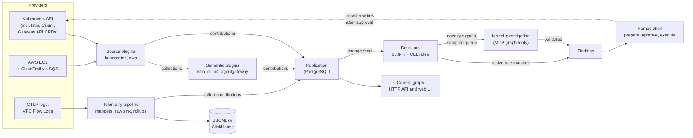

# What AgentShield does

## The problem

A Kubernetes cluster with a service mesh, a CNI, and an AI gateway has security controls in many places. NetworkPolicies, CiliumNetworkPolicies, Istio AuthorizationPolicies and PeerAuthentications, Gateway routes, and AWS Security Groups each describe part of who can reach what. No single API answers questions such as:

- A workload just started talking to a service it never called before. Is that new path allowed by policy, or did a policy disappear?
- A change removed the only policy that governed a Pod. What can now reach it?
- A control-plane workload is sending traffic to a public address it has never contacted. Is that expected?

Lateral movement looks like ordinary traffic and ordinary configuration changes. Spotting it means joining inventory, policy, and observed traffic from several providers and then reasoning about the result with evidence.

## The approach

AgentShield does this in four steps:

1. **Discover.** Plugins read provider state (Kubernetes objects, Istio and Cilium CRDs, Gateway API, AWS EC2) and translate it into graph assertions. Each resource gets a stable identity based on an immutable provider key, such as a Kubernetes UID qualified by cluster ID.
2. **Observe.** A telemetry pipeline receives traffic records (OTLP logs from an existing OpenTelemetry Collector, or AWS VPC Flow Logs through Firehose), writes the raw events to JSONL or ClickHouse, and adds per-minute traffic summaries to the graph.
3. **Detect.** Every graph change is recorded in an ordered change feed. Detectors compare the previous and current graph and emit signals: new exposure, a lost policy, a changed security setting, a new RBAC binding, or a workload reaching a destination it never reached before. Operators can add CEL rules, and a model can draft a rule for each Deployment for an operator to approve. An active rule's match becomes a finding directly.
4. **Investigate and remediate.** When a novelty signal fires, a language model investigates it through read-only graph queries (served over MCP), from a sampled queue that bounds model spend. AgentShield validates the model's answer against the graph before it records a finding. A finding can carry suggested remediations. A user must explicitly prepare and approve a remediation before AgentShield changes anything in the cluster.

The graph is provider-neutral. Detectors and the model read a common security vocabulary (see [security semantics](security-semantics.md)) instead of provider-specific fields, so a rule about "lost governance" works whether the policy was a Kubernetes NetworkPolicy, a Cilium policy, or an AWS Security Group.

## Pipeline

This is the end-to-end flow.

## Components

| Component | Code | What it does | Details |
| --- | --- | --- | --- |
| Discovery plugins | `plugins/*`, `pkg/discovery` | Read provider state and publish graph assertions | [Plugins](../plugins/README.md) |
| Graph compiler | `pkg/graph` | Validates assertions, derives stable IDs, and builds the graph deterministically | [Data model](data-model.md) |
| State store | `pkg/state` | Stores contributions, versions, the current graph, the change feed, findings, and rules in PostgreSQL | [Publication and storage](../architecture/publication-and-storage.md) |
| Telemetry pipeline | `pkg/telemetry` | Receives traffic records, writes raw events, and maintains per-minute graph rollups | [Telemetry](../architecture/telemetry.md) |
| Detectors | `pkg/detector` | Turn graph changes into signals using built-in checks, CEL rules, and Deployment rules | [Detection rules](../architecture/detection-rules.md) |
| Detection and investigation | `pkg/reasoning` | Reads the change feed, records signals and rule findings, and queues novelty signals for a sampled model investigation whose validated answers become findings | [Change feed and reasoning](../architecture/change-feed-and-reasoning.md) |
| Remediation | `pkg/remediation`, plugin `remediation.go` files | Plans, dry-runs, executes, and verifies approved provider changes | [Remediation](../architecture/remediation.md) |
| HTTP API and UI | `pkg/api`, `ui/` | Serves the graph, findings, and remediation workflow; embeds the React UI | [Architecture overview](../architecture/overview.md) |

## What AgentShield does not do

- It does not prove that a policy is enforced. Declared configuration and controller status are recorded as declared or observed, not effective. See [security semantics](security-semantics.md).
- It does not apply changes on its own. Reasoning, detection, and graph publication never execute a remediation.
- It does not authenticate API callers. See the [security model](../operations/security-model.md).

Next: the [glossary](glossary.md) defines the terms used across the docs, and the [data model](data-model.md) explains identities and assertions.
