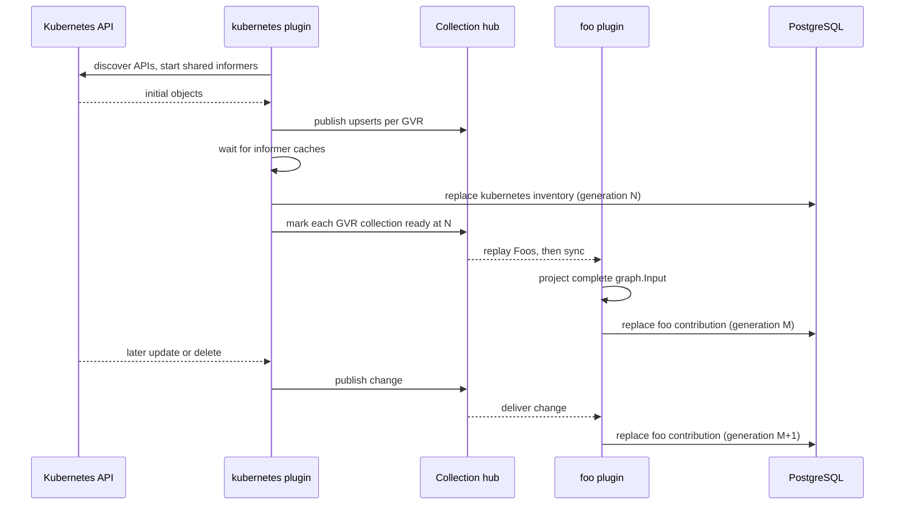
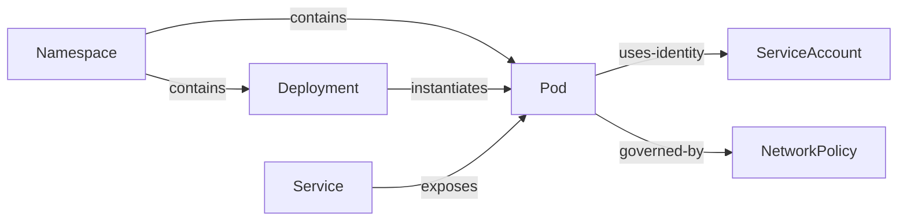

# Tutorial: the life of a plugin

This walkthrough follows a sample plugin, `foo`, from a Kubernetes custom resource to the graph. `foo` is not in the repository; it is modeled on the real `istio` plugin, and the [code map](#code-map) at the end points to the real code for each step.

`foo` is a semantic plugin: it projects Foo objects, which the Kubernetes plugin watches for it, into graph assertions, and maps a Foo-specific OTLP log format into telemetry events. The [plugin contract](README.md) has the rules and the [glossary](../concepts/glossary.md) the terms.

## 1. Declare what `foo` needs and owns

```go
func New() (*Plugin, error) {
    foos, err := kubernetes.NewResourceClient(kubernetes.ResourceRequirement{
        GVR:        schema.GroupVersionResource{Group: "foo.example.io", Version: "v1", Resource: "foos"},
        Capability: "foo-v1",
    }, decodeFoo)
    if err != nil {
        return nil, err
    }
    return &Plugin{foos: foos}, nil
}

func (p *Plugin) KubernetesResources() []kubernetes.ResourceRequirement {
    return []kubernetes.ResourceRequirement{p.foos.Requirement()}
}

func (p *Plugin) Descriptor() discovery.Descriptor {
    return discovery.Descriptor{
        ID:          "foo",
        Version:     "0.1.0",
        Description: "Foo security semantics",
        Consumes:    []string{p.foos.Collection(), kubernetes.CollectionResourceCoverage},
        Publishes:   []string{"foo/projection"},
    }
}

func (p *Plugin) SourceID() string { return p.sourceID }
```

At startup the Kubernetes plugin opens one informer for `foo.example.io/v1/foos` and publishes it as the collection `kubernetes/resources/foo.example.io/v1/foos`. Any other plugin that needs Foos shares it. Because `Required` defaults to `false`, a cluster without the CRD reports `unsupported` coverage instead of failing.

`foo` registers no identity scheme. It names Kubernetes objects with the existing `kubernetes.io/v1, Kind=Object` scheme (cluster ID plus `lowercase(apiVersion/kind/UID)`), so a Foo, the Pod it selects, and a telemetry event about that Pod all land on the same graph nodes.

## 2. Receive observations

The Kubernetes plugin turns informer callbacks into `discovery.Change` values:

| Field | Value |
| --- | --- |
| `PluginID`, `SourceID` | `kubernetes`, the configured source ID |
| `Collection` | `kubernetes/resources/foo.example.io/v1/foos` |
| `Key` | `lowercase(apiVersion/kind/UID)` |
| `Revision` | Kubernetes `resourceVersion` |
| `Operation` | `upsert`, `delete`, or `sync` |
| `EventID` | Stable ID built from plugin, collection, key, revision, and operation |
| `Payload` | Object JSON, for upserts only |

`Runtime.Publish` stores each change's metadata and content digest as a native-event receipt in PostgreSQL, then delivers its payload through the in-memory collection hub. PostgreSQL does not retain the payload. A new subscriber gets every current item sorted by key (with `Initial=true`), then the last `sync` marker, then live changes.

The publisher never waits for a slow subscriber. Each subscriber's channel holds its replay plus 1,024 live changes (a constant in `pkg/discovery/hub.go`). When it is full, the hub keeps only the latest pending change per key and the newest `sync` marker, delivers them as the subscriber catches up, and logs a warning (at most once a minute). A lagging subscriber can skip intermediate versions of an object, but it never misses a delete, and a `sync` marker always arrives after the state it marks. So `foo` treats each change as "the current state of this key", not as a step in a sequence.

The channel closes only when the subscriber's context ends. If it closes while `foo` is running, `foo` returns an error from `Run` and the manager restarts `foo` alone, as described under [Errors](README.md#errors).

### Initial sync



`foo` publishes nothing until it has the `sync` marker of every collection it consumes, including `kubernetes/resource-coverage`. Publishing earlier would retract facts that simply had not arrived yet.

## 3. Project

The projector turns a copied, sorted snapshot into `graph.Input` with no I/O. It builds its indexes once, then runs small per-resource functions in a fixed order.

Suppose the cache holds a namespace, a Deployment and its ReplicaSet, a Pod, a Service and a NetworkPolicy that select the Pod, and the Pod's ServiceAccount. The Kubernetes plugin's part of the graph looks like this:



The ReplicaSet is not a node: the Kubernetes projector follows it to find the Deployment and emits `instantiates` directly.

`graph.Input` holds four assertion types:

| Assertion | Says | Example |
| --- | --- | --- |
| `ResourceAssertion` | A resource exists, with a kind and attributes | A Deployment |
| `RelationshipAssertion` | A registered predicate joins two identities | Service `exposes` Pod |
| `FacetAssertion` | An aspect applies to a resource | `foo-policy` on a Pod |
| `TelemetryAssertion` | Traffic was observed between two resources | One minute of requests from A to B |

Every assertion carries `pluginId`, `sourceId`, a `ruleId` such as `foo.policy.target`, and sorted `evidenceIds`. A Foo-to-Pod edge cites both the Foo and the Pod.

If a Foo restricts ingress, `foo` attaches `graph.SecuritySemantics` to the facet or relationship, with honest `state` and `coverage`, next to the native attributes. See [security semantics](../concepts/security-semantics.md).

If a required field is malformed, the projector returns an error, `foo` publishes nothing, and the last good contribution stays active.

## 4. Publish

`foo` calls `ReplaceContribution` with its whole output as the next generation, contribution name `semantics`, `Ready: true`, and `SourceHealth: "healthy"`. On startup it reads `ContributionGeneration` and continues from there ([Publication and storage](../architecture/publication-and-storage.md) has the details).

When a Foo is deleted, `foo` drops it from its cache, projects again, and publishes. The Foo's facets and edges are missing from the new generation, so they are retracted. The Kubernetes plugin's assertions about the Pod are untouched, because they belong to its own contribution.

`foo` may point at a Pod that the Kubernetes plugin has not published yet. The edge stays unresolved until the Pod arrives; neither plugin waits for the other.

## 5. Add telemetry

`foo` implements `discovery.TelemetryMappingProvider` and returns one `telemetry.Mapping` for plugin `foo` and its source ID. For each OTLP record, the receiver finds exactly one mapper whose `Match` accepts it; `foo` checks a stable attribute its collector config sets. `Map` then:

1. keeps a retry-stable event ID and the original timestamp;
2. resolves subject and object to complete identity claims (the Istio mapper, for example, accepts a UID or resolves kind/namespace/name through its Kubernetes cache);
3. keeps subject-to-object direction regardless of where the log was produced;
4. sets kind, operation, outcome, coverage, and count;
5. adds small, non-sensitive properties and evidence IDs.

Records `foo` cannot map return an error and are rejected one by one. The pipeline writes each batch to the raw sink, then adds it to per-minute rollups, which the host publishes as `foo`'s `rollups` contribution. See [Telemetry](../architecture/telemetry.md).

## 6. When things go wrong

The [contract's rules](README.md#rules) say what to do about missing APIs, malformed input, provider outages, and closed subscriptions; [Telemetry](../architecture/telemetry.md#failure-behavior) covers sink failures and unknown endpoints. The tests to write are in [Plugins: Testing](README.md#testing).

## Code map

| File | What to read it for |
| --- | --- |
| `pkg/discovery/contracts.go` | `Plugin`, `Descriptor`, `Change`, `Runtime`, `ContributionOutput`, optional capabilities |
| `pkg/discovery/hub.go` | Replay, sync markers, and how lagging subscribers are coalesced |
| `pkg/discovery/runtime.go` | Native-event storage, runtime scoping, and the manager |
| `plugins/kubernetes/client.go` | `ResourceRequirement`, `ResourceClient`, and collection names |
| `plugins/kubernetes/plugin.go` | API discovery, shared informers, coverage, and publication |
| `plugins/kubernetes/project.go` | Inventory and topology projection |
| `plugins/istio/plugin.go` | A real semantic plugin consuming Kubernetes collections |
| `plugins/istio/telemetry.go` | A real OTLP mapper with identity resolution |
| `pkg/telemetry/pipeline.go`, `pkg/telemetry/rollup.go` | Backpressure, sink-before-graph ordering, and rollups |
| `pkg/graph/graph.go` | Assertion types, identity normalization, validation, and compilation |
| `pkg/state/versioned.go` | The publication transaction |
| `cmd/agentshield/main.go` | Wiring plugins, telemetry, and the HTTP server |
